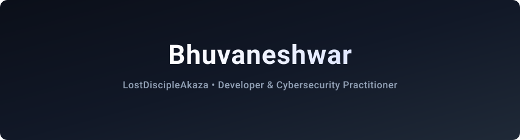
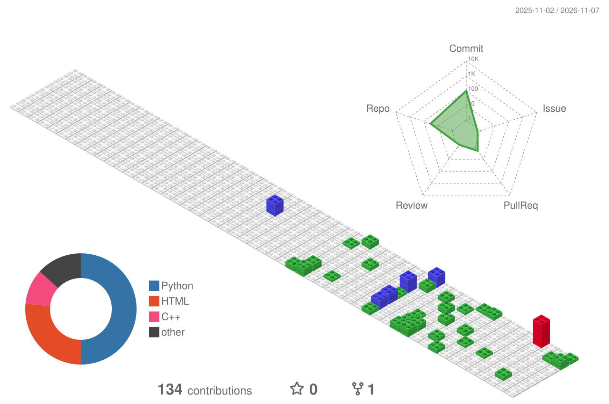
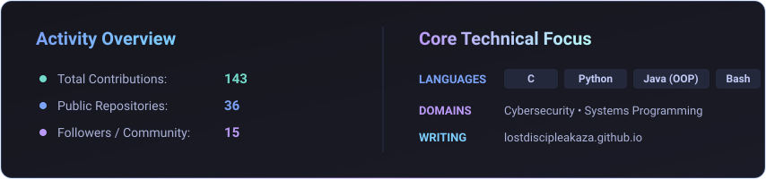

<!-- Header Banner -->

<!-- Typing Animation Subtitle -->

  

<!-- Social Links Badges -->

  
  
  
  

---

## 👨‍💻 About Me

- 🛡️ **Cybersecurity Practitioner** exploring defensive systems, penetration concepts, and secure coding
- 💻 **Software Developer** building terminal tools, software rendering engines, and robust applications
- ✍️ **Part-time Writer** crafting original fiction, essays, and reflections — read my stories on [**lostdiscipleakaza.github.io**](https://lostdiscipleakaza.github.io/)
- 🎯 **Current Focus**: Low-level systems programming, algorithms, and defensive security

---

## 🛠️ Tech Stack

  
  
  
  

 

  
  
  
  

---

## 🚀 Featured Projects

| Project | Description | Stack / Category |
| :--- | :--- | :--- |
| 📖 **[LostDiscipleAkaza Stories](https://lostdiscipleakaza.github.io/)** | Personal publication space featuring original stories (*The Girl in Blue*, *A Shadow that Fell in Love with the Light*, *Anamnesis Echo*). | `Writing` `Literature` `GitHub Pages` |
| 🎨 **[ASCII Rendering Engine](https://github.com/LostDiscipleAkaza/ASCII-Rendering-Engine)** | Software rendering engine converting 2D images and 3D models into colorful, interactive ASCII art in your terminal. | `C` `Computer Graphics` `CLI` |
| 🤖 **[KiwiBot](https://github.com/19KB-Studio/kiwiBot)** | A Discord bot that keeps tech communities updated daily with curated AI, tech, and cybersecurity news. | `Python` `Discord API` `Automation` |
| ♟️ **[Chess Website](https://github.com/LostDiscipleAkaza/chess-website)** | Interactive chess platform supporting local pass & play along with personality-driven AI bots. | `AI` `Web` |

---

## 📊 3D Contribution Graph

  

---

## 📈 Activity & Metrics

  

---

## 🖋️ Words & Literary Reflections

### 💭 Voices I Admire

> *"You are the knife I turn inside myself; that is love. That, my dear, is love."*  
> — **Franz Kafka**, *Letters to Milena*

> *"My God, a whole moment of happiness! Is that too little, even for the whole of a man's life?"*  
> — **Fyodor Dostoevsky**, *White Nights*

> *"In the midst of winter, I found there was, within me, an invincible summer."*  
> — **Albert Camus**, *Return to Tipasa*

> *"I took a deep breath and listened to the old brag of my heart: I am, I am, I am."*  
> — **Sylvia Plath**, *The Bell Jar*

> *"Perhaps one did not want to be loved so much as to be understood."*  
> — **George Orwell**, *1984*

> *"He who has a why to live can bear almost any how."*  
> — **Friedrich Nietzsche**, *Twilight of the Idols*

> *"The philosophers have only interpreted the world in various ways; the point, however, is to change it."*  
> — **Karl Marx**, *Theses on Feuerbach*

---

### 📖 From My Stories

> 🌐 **Full stories and upcoming pieces are published at [lostdiscipleakaza.github.io](https://lostdiscipleakaza.github.io/)**

> *"She had chosen Bharat for love, and him for survival within loneliness."*  
> — **A Shadow that Fell in Love with the Light**

> *"Love is often nothing more than the wish to take another person’s pain into one’s own body."*  
> — **The Girl in Blue**

> *"In the end, the shadow did not become the light. It simply learned how to live without it."*  
> — **A Shadow that Fell in Love with the Light**

> *"Somewhere in the world, a man who loved you silently is still keeping his promise."*  
> — **The Girl in Blue**

> *"I did not lose you. You were never mine to lose, and that is the grief that has no grave."*  
> — **Reflections on Silent Grief**

> *"Constants are never meaningless."*  
> — **Anamnesis Echo**

<b>📜 More Excerpts & Selected Lines from My Writings</b>

 

#### From *The Girl in Blue*
- *“Their words struck me like stones thrown at a window behind which a child is sleeping.”*
- *“The wound you felt that day ended with the night; the wound I carry has learned how to live inside time.”*
- *“That night my heart broke without sound.”*
- *“Even when your voice no longer reaches me, my silence continues speaking your name.”*
- *“How cruelly we learn the value of moments only after time has taken it from us.”*
- *“I no longer ask that you become mine. I ask only that life be gentle with you.”*
- *“I shall take those magic moments to my grave, where even death will have to learn that there was once a girl who made an ordinary life feel like sunlight.”*

#### From *A Shadow that Fell in Love with the Light*
- *“What people call adjustment is often just a well practiced form of absence.”*
- *“Sometimes, it comes from the quiet refusal to fall back into what you have already survived.”*
- *“Some people do not stay in your life forever. They simply arrive long enough to return forgotten parts of you back to yourself.”*
- *“Just two people continuing their lives after surviving a story that only one of them truly lived.”*
- *“He was not mourning rejection. He was mourning meaning itself.”*
- *“Nothing had really been lost. There had never been anything to lose.”*

#### From *Anamnesis Echo*
- *“Constants are never meaningless.”*
- *“Live. Laugh. Break. Love. Live every breath, every moment.”*

#### Silent Echoes & Story Themes
- *“Some people love you loudly. Others love you so quietly that you never learn what they carried for you.”*
- *“He never asked to be remembered. He only asked that she be safe.”*
- *“A shadow does not envy the light. It only remembers who it was standing beside.”*
- *“Pushing her away was the only way his love knew to hold her.”*
- *“Not every ending is a goodbye. Some are just a promise kept from a distance.”*
- *“To you it was an ordinary Tuesday. To me it was the day my whole life changed direction.”*
- *“I prayed for your happiness, and God answered, just not in my direction.”*
- *“The hardest part of loving someone silently is that no one comes to mourn it with you.”*
- *“You will never know how many times I was the reason you were okay.”*
- *“I knew your favourite flower, your fears, your favourite song, and still I was a stranger who had no right to miss you.”*
- *“Some people break your heart. You broke mine without ever knowing it was in your hands.”*

---

## 📬 Get in Touch

Feel free to connect or drop a message:

- 📖 **Stories & Articles:** [lostdiscipleakaza.github.io](https://lostdiscipleakaza.github.io/)
- 📧 **Email:** [bhuvaneshwar535@gmail.com](mailto:bhuvaneshwar535@gmail.com)
- 📸 **Instagram:** [@\_bhuviii\_\_01](https://instagram.com/_bhuviii__01)
- 🐙 **GitHub:** [@LostDiscipleAkaza](https://github.com/LostDiscipleAkaza)
